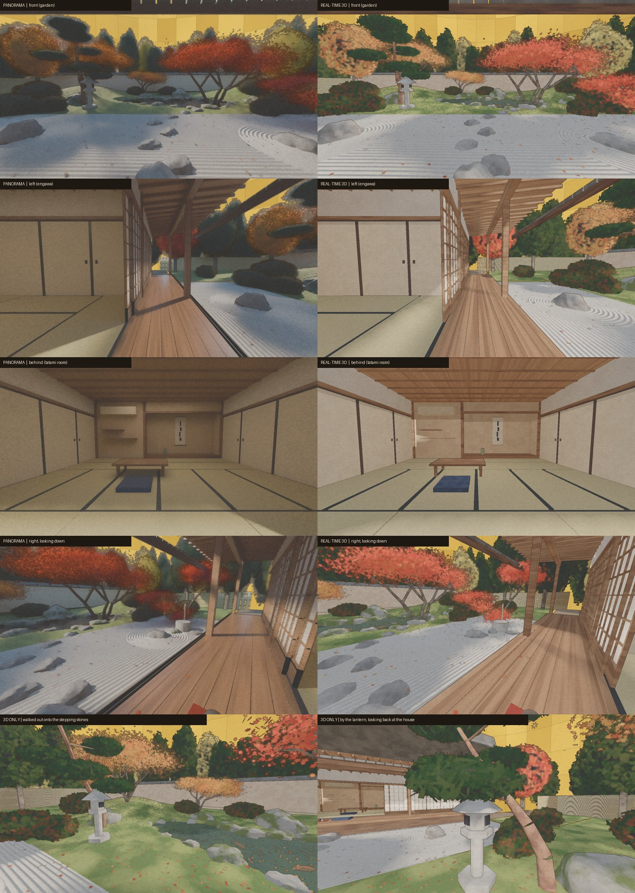
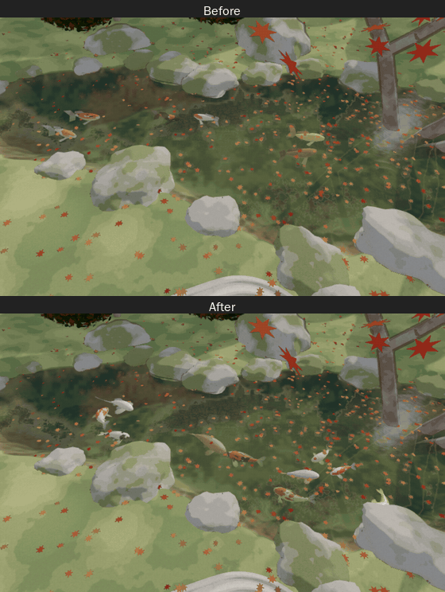
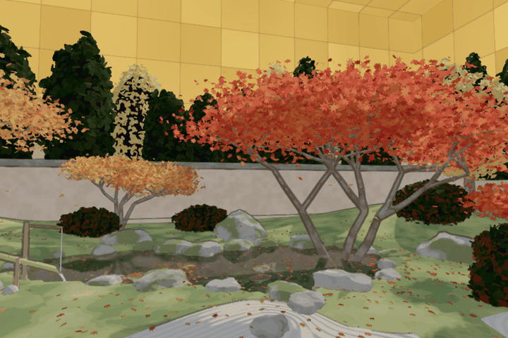

# Teien: a Nihonga Garden

An autumn Japanese garden, seen from the engawa of a tatami room, that you can sit in, look around and walk through in the browser. The scene is modelled procedurally in Blender, exported to glTF, and painted live in WebGL in the manner of *nihonga* (Japanese mineral-pigment painting): flat washes, gold-leaf haze, ink outlines.

**Live:** https://hayeah.github.io/teien/



What's in the scene:

- Maples, ginkgo and pines with instanced leaves that sway in the breeze and drift down
- A koi pond with lotus pads and flowers, grasses, rippling water, caustics, and koi that school, wander and come to feed
- Raked gravel, moss, stepping stones, a stone lantern and a *shishi-odoshi* (bamboo deer scarer) with its knock
- Paper shoji doors open on both sides, the tatami room behind you




## Run it locally

The page is static, but it loads its model with `fetch`, so it needs a local web server rather than `file://`:

```sh
cd docs
python3 -m http.server 8000
# open http://localhost:8000
```

Three.js 0.170 is loaded from the jsDelivr CDN, so you need an internet connection.

## Controls

| Input | Action |
| --- | --- |
| Drag / click | Look around (click locks the mouse, Esc frees it) |
| W A S D | Walk |
| Shift | Walk faster |
| R / F | Stand up / sit down |
| H | Back to the cushion |
| P | Painting on or off |
| M | Sound on or off |
| E | Feed the koi (where you look, or the nearest water) |

On touch screens, drag to look and use the on-screen arrow pad to walk.

## Layout

```
docs/      the web page (mirrored to the gh-pages branch, which GitHub Pages serves)
  index.html    scene setup, nihonga post-processing, controls
  pond.js       water, pond bed, caustics
  koi.js        koi models and behaviour
  pondplants.js lotus and grasses around the pond
  shishi.js     shishi-odoshi animation and sound
  garden.glb    the garden geometry exported from Blender
  leaves.bin/.json, height.bin/.json, materials.json   leaf instances, terrain height, material recipes
blender/
  build_garden.py      builds the whole garden procedurally in Blender
  export_realtime.py   exports garden.glb and the data files for the web page
media/     screenshots and GIFs for this README
```

To rebuild the scene, run `build_garden.py` in Blender (it was made with Blender 5.x), then `export_realtime.py` to regenerate the files in `docs/`.

To publish changes to the live page, push the `docs/` folder to the `gh-pages` branch:

```sh
git push origin $(git subtree split --prefix docs main):refs/heads/gh-pages
```
